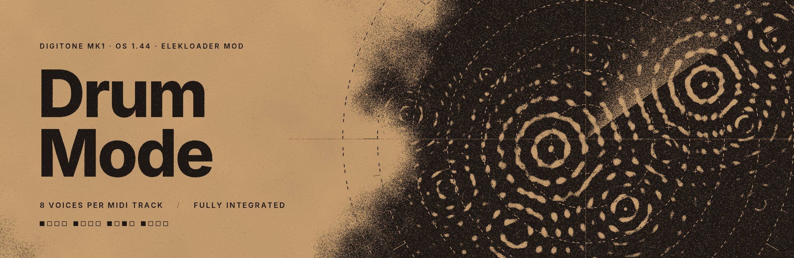

# Drum Mode

A custom-firmware mod for the **Elektron Digitone mk1 (OS 1.44)** that turns one
MIDI track into a drum track with up to **8 lanes**. Each lane sends its own note
on the track's single MIDI channel, so you can play and program several drum
notes at once, and see each lane trigger.

Inspired by the drum sequencers of the Elektron Digitakt and the Arturia
BeatStep Pro. Built on [elekloader](https://github.com/irpina/elekloader)'s
Digitone mk1 core and its sequencer-events mod.

> **Beta: working on the unit.** 0.10.6 passed its unit test on 2026-11-24 (OS 1.44); 0.11.0 adds ratchets and note repeat (emulator): pads,
> recording, grid editing, the running light, DRUM pages, mutes, settings per pattern, pattern
> and bank select and chains all work. One bug is open (a pattern reload and the kits); a few choices are parked. See
> [Known bugs](#known-bugs) and [docs/debugging.md](docs/debugging.md).

**Docs:** the [user manual](docs/MANUAL.md) (installing, every feature, troubleshooting), the
[UI additions](docs/ui/README.md) (every screen, key and LED Drum Mode adds), the
[design notes](docs/design.md) (how it works inside, findings) and the
[debugging log](docs/debugging.md).

## What it does (0.11.0)

- **Drum Mode per MIDI track and per pattern:** hold the track key → Mod Menu → DRUM MODE.
- **8 drum pads** on trig keys 1–8, each lane with its own note and velocity, all on the
  track's MIDI channel (GM notes to start with); a pad also selects its lane.
- **Live recording** writes the pads into the pattern as normal MIDI trigs (several drums on
  one step become the trig's chord notes).
- **Grid editing per lane:** in GRID RECORDING the 16 trig keys place and show the selected
  lane's steps; a held step takes the stock's locks, micro timing and copy/paste.
- **Lane mutes** with FUNC + pad (outside recording).
- **Ratchets (0.11):** a drum on a step plays 2, 3 or 4 times within it (hi-hat rolls, snare
  fills), set per drum per step with knob E (ROLL) of the TRIG page on held steps in GRID
  RECORDING.
- **Note repeat (0.11):** knob G (RPT) of the TRIG page sets 1/16, 1/32 or 1/64; a held pad then
  repeats in time while playing, and LIVE RECORDING writes what you hear (with its rolls).
- **A DRUM page** behind the MIDI track's LFO key for all lanes' notes, and LFO again for their
  velocities (one mod page since 0.10.4).
- **On screen and LEDs:** a lane strip that follows playback, the selected lane's pad lit, and
  keys 1–16 as a running light in time with the pattern: one key per step, red for the whole
  step like the stock's playhead (0.10.6).
- **Settings per pattern and per track,** kits (notes and velocities) shared in the project,
  at most 10; a new pattern starts with Drum Mode off and the default notes (0.10.3, being
  tried out).
- **The stock's own trig key functions stay:** pattern and bank select, chains, FUNC + trig in
  recording.

## Plans

**Nice to have**
- **Screen overview of all lanes:** an 8 × 16 grid, e.g. shown while TRIG is held, the
  selected lane highlighted.
- **A revised DRUM settings page** (its place behind LFO, layout, what it shows), after use on
  the unit.
- **Drum kit presets with a browser** (asked 2026-11-22): double-tap the MIDI track key while
  Drum Mode is on to open a kit browser, browsed and loaded like a synth Sound (LEVEL/DATA or
  UP/DOWN to scroll, pads to preview, YES loads onto the track for this pattern, NO closes). The
  stock does nothing with a double tap on a MIDI track (the Sound Browser is synth only; to check
  in the emulator); holding the key still opens the Mod Menu. Storage, in steps:
  1. built-in kits in the firmware (e.g. GM, TR-808, TR-909 note layouts) plus the project's own
     kits: no storage needed, safe;
  2. a few named presets of your own in the project: little room (the ~480 bytes all mods share,
     already used by the 10 kits);
  3. a library across projects on the +Drive: core can read and write raw +Drive sectors, but
     Elektron's file system is there too, so first research whether a safe free area exists (a
     SysEx dump to the computer and back would be the workaround).
- **Synth tracks as extra drum tracks, or as normal MIDI tracks:** a synth track you don't need
  sends its steps as MIDI (its voice silent), for up to 8 drum or MIDI tracks. Not more tracks:
  the format has exactly 4 synth + 4 MIDI. The hard part is timing each note and its note-off.

**The elekloader Shop listing:** submitted on 2026-11-25 (release v0.10.6 with a card picture from
`docs/banner/thumb.py`; [elekloader/shop#84](https://github.com/elekloader/shop/issues/84)). The bot's check
passed and opened [pull request #85](https://github.com/elekloader/shop/pull/85); once a maintainer merges it,
Drum Mode can be ticked on the Shop page. Later releases go in by themselves (daily check).

**Modwerk:** not listed yet. Modwerk keeps its own catalogue; its Digitone support is a preview on core-dn1 2.2,
and its rules refuse a module that `requires` another (Drum Mode needs core 5.3+ and seq-events, for playback,
LEDs, pattern copy and the step events). A port to core 2.2 would mean leaving those out. Asked the maintainers on
2026-11-25 whether the Digitone base moves to core 5.x with the sequencer events; if so, the module folder
(manifest, screenshots, hardware report) follows.

**Possible additions after v1** (ideas from 2026-11-19, once the current features work on the
unit)
- **Step recording for drums:** in STEP RECORDING, pad 1–8 places that lane's note on the active
  step and moves one step on, like the stock's keyboard (now it works like GRID RECORDING). To
  add or investigate later.
- **Euclidean / fill generator per voice:** pick a voice, set e.g. 5 hits over 16 steps and an
  offset, and Drum Mode writes the steps.
- **Different lengths per voice:** e.g. kick over 16 steps, hats over 12, percussion over 7, for
  polyrhythms. Ambitious: a Digitone track has a single length.
- **Probability and humanize per voice:** e.g. hats play 70% of the time, or small random
  velocity and timing shifts. The stock trig conditions work per step, not per voice.

**To decide after testing**
- **What a new pattern starts with.** Until 0.10.2 it copied the pattern you came from (the
  user's choice, 2026-11-19). On the unit (2026-11-22) that made Drum Mode look global: all older
  patterns took on/off and the notes from the pattern you came from (also notes changed with pad
  + knob). *Since 0.10.3, to try for now:* a new pattern copies **nothing**: Drum Mode **off**,
  the default (GM) notes, no mutes; you turn it on per pattern. It keeps no settings (and uses no
  kit) until you change one there. Copying on purpose stays with FUNC + RECORD / FUNC + STOP.
  To look at again later.

**Done** (asked by the user): a pad selects its lane, lit (0.9); keys 9–16 as a running light
(0.9.1), moved to keys 1–16, one LED per step (0.10.5, asked 2026-11-24), red and lit for the whole
step like the stock's playhead (0.10.6); settings per pattern and per track (0.10).

## Known bugs

**Open**
- **A pattern reload brings back the wrong kit** (found on the unit, 0.10.6, 2026-11-25: an older pattern
  showed the newest kit). Drum Mode keeps the kits in one pool in the project (at most 10) and each pattern
  only its kit's number, so a pattern save (FUNC + YES) keeps the number, not the notes. If that kit is
  changed or freed afterwards, a reload (FUNC + NO, or SETTINGS > PATTERN > RELOAD FROM PROJ) gives Drum Mode
  off with the default kit (the kit was freed; measured in the emulator: save with kick 40, change to 45,
  reload: off, kick 36) or another pattern's newer kit (its number was reused). *Plan:* a kit a saved pattern
  still points to is never edited in place or reused; an edit makes a copy, so the reload gets the saved
  kit back. Also check the SETTINGS menu's reload, which core may not report to Drum Mode.
- **Trig keys while a menu is open** go to Drum Mode on a Drum Mode track. The SCALE menu uses
  them (handed to the stock in 0.10.2). Checked in the emulator (2026-11-22): PTN + trig (pattern
  copy/clear) is the stock's already (PTN held); the Sound Browser is for synth tracks only.
- **MUTE mode (FUNC + BANK)** on a Drum Mode track: the pads still play (stock: the trig keys play
  nothing in MUTE mode, the track keys mute). *To decide:* keep the pads playing, or leave the trig
  keys to the stock there. *Decide later* (the user, 2026-11-22).
- **STEP RECORDING (RECORD + STOP)** on a Drum Mode track works like GRID RECORDING: the 16 keys
  are the selected lane's steps, no sound (stock: a trig key places its note on the active step and
  moves one step on). *Kept as it is* (the user, 2026-11-22); the drum version is on the list of
  possible additions.
- **The UI froze with the Mod Menu open (emulator only, cause unknown),** in one exact sequence
  of `tests/test_drum_off.py`. *Next:* watch for it on the unit. Details in
  [docs/design.md](docs/design.md) ("Open: a UI hang in the emulator").

**To check on the unit**
- **0.11.0: ratchets.** In GRID RECORDING select a drum (its pad), hold a step it plays and turn
  knob E on the TRIG page: the box shows ROLL x2-x4 and the step's LED turns white. Playing, that
  drum plays 2-4 times within the step, evenly; other drums on the step play once; a muted drum
  doesn't roll. Removing the drum from the step takes its roll away (passes in the emulator).
- **0.11.0: note repeat.** Knob G on the TRIG page (RPT: -, 16, 32, 64). While playing, a held pad
  repeats in time and stops when you let go. Held in LIVE RECORDING, the steps you hold through
  are recorded, at 32 or 64 with roll 2 or 4, and play back as heard (passes in the emulator).
  Listen for how tight the extra hits are on the unit, and whether MIDI notes from Drum Mode's
  own task and the stock's ever get in each other's way.
- **The 1.5-second rule (0.9.2):** *Unit (2026-11-24): seems to work; final confirmation later.*
  After a bank pick (BANK + trig 16) the emulator never sent that key's release, so a trig key
  Drum Mode left to the stock counts as released after 1.5 s without events. Check that the trig
  keys come back to Drum Mode after a bank pick, that a chain held past 1.5 s still works, and
  whether a cleaner way exists (the firmware's own held-key state).

**Unit test results**
- **0.10.6 (2026-11-24): all pass.**
  - The running light: keys 1–16, one per step, red for the whole step like the stock's
    playhead (0.10.5 was white and lit half a step, which looked flickery). Looks good next to
    muted lanes.
  - The LFO page says "LFO" (the stock said "LFO (1/2)", counting DRUM as page 2).
  - The DRUM page counter: Drum Notes (1/2), Drum Velocity (2/2) (0.10.4 said 2/2 on Drum Notes
    and nothing on Drum Velocity).
  - One DRUM page, LFO switching Drum Notes and Drum Velocity (0.10.4).
  - A new pattern starts with Drum Mode off and the default notes (0.10.3).
  - Pattern length with the trig keys in the SCALE menu (0.10.2).
  - The stock's pattern and bank LEDs while PTN or BANK is held (0.10.1).
  - Pattern chains, the manual's way: hold PTN, press the first pattern's key, release PTN, keep
    that key held and press the next ones (manual 10.10.1).
  - The ROOT box on a held step shows the right note.
- **0.10 (2026-11-22):** passed: boot, pads, live and grid recording, held-step locks, running
  light, lane strip, DRUM pages, mutes, FUNC + trig keys in recording, settings per pattern,
  copy/paste, FUNC + NO reload, save/load, synth tracks. Found: the PTN/BANK LEDs, pattern
  length in the SCALE menu, settings that looked global across patterns (all fixed above).

**Known limits**
- A **NOTE lock** on a drum step changes its notes; a **velocity lock** is kept, but Drum Mode
  plays the step at its lanes' velocity, so it has no effect.
- **At most 10 kits** per project (`KIT MEM FULL`), and the per-pattern settings take one of a
  pattern's 80 lock rows.
- **Saving on the stock OS** drops Drum Mode's settings (the steps stay).
- **Pattern copy/paste with PTN + trig key** (then RECORD / STOP) copies the steps, but not the
  Drum Mode settings; FUNC + RECORD / FUNC + STOP copies both. (The trig keys go to the stock
  there, PTN held.)

**Fixed** (details in the [debugging log](docs/debugging.md) and the
[design notes](docs/design.md))
- **"Drum Mode off" on screen and the track unusable** (0.10, 2026-11-22): not a bug. It was the
  DRUM page on a track without Drum Mode (the page stays when you switch tracks), which shows
  `DRUM MODE IS OFF` and takes no knobs. Press another page key or turn Drum Mode on (the user,
  2026-11-24).
- **The DRUM page counter** and the LFO page's "(1/2)" (0.10.5, 0.10.6); the running light white
  and flickery (0.10.6).
- **The ROOT box on a held step** was planned to show the selected lane's note; on the unit
  (2026-11-24) it shows correctly.
- **The DRUM pages clashed with other mods' pages** (0.10.4). The Digitone mk1 has four mod
  pages (27–30): core takes 30, machines-dn1 28 and 29, CTRL-PLUS 29, DigiTables 27 (OS 1.43
  only). Drum Mode used 27 and 28, so it couldn't be combined with machines-dn1. Now Drum Notes
  and Drum Velocity share page 27 (LFO on Drum Notes switches to Drum Velocity), and Drum Mode
  links with machines-dn1 0.6, Filter-FX and CTRL-PLUS.
- Recorded beats didn't play back on the unit: written into another pattern's data (0.8.2,
  confirmed on the unit).
- The DRUM pages came up empty and the corner strip vanished after picking a pattern with BANK
  or PTN: an empty firmware view stayed on top (0.8.3).
- Pattern and bank select, chains and held grid steps didn't reach the stock on a Drum Mode
  track (0.9.2); FUNC + pad muted a lane while recording (0.9.3).
- Step 1 after PLAY followed the setting from before a change made while stopped (0.9.4).
- Per-pattern settings weren't saved: the first design didn't fit core's 480 bytes of project
  data (redone before release, 0.10).

## Building

You need your own copy of the stock Digitone OS 1.44 `.syx` from Elektron, plus
git, python3 and an m68k cross toolchain (`m68k-elf-gcc` or `m68k-linux-gnu-gcc`;
on Debian/Ubuntu: `apt install gcc-m68k-linux-gnu`).

```
./build.sh /path/to/Digitone_and_Digitone_Keys_OS1.44.syx
```

This fetches [elekloader](https://github.com/irpina/elekloader) at a fixed commit
(core-dn1 5.4, seq-events-dn1 0.1), builds them and the mod in `src/`, checks they
combine, and writes `out/Digitone_OS1.44_DrumMode.syx`, shown as OS version
**D110** on the unit (the label follows the version: D100 = 0.10, D110 = 0.11.0).

## Testing in the emulator

The tests run the real firmware in [digiemu](https://github.com/irpina/digiemu),
press keys and check the MIDI the Digitone sends:

```
git clone https://github.com/irpina/digiemu ~/digiemu
cd ~/digiemu && uv sync && tools/install-patched-unicorn.sh
for t in tests/test_*.py; do
    DIGIEMU=~/digiemu uv run --project ~/digiemu python "$t" out/Digitone_OS1.44_DrumMode.syx
done
```

Each test set takes a few minutes; screenshots land in its work folder. All 13 sets
(231 checks) pass on 0.11.0.

## Layout

| Path | What |
| --- | --- |
| `src/mod.json` | Mod manifest: events it subscribes to, what it needs |
| `src/drummode.c` | The mod |
| `build.sh` | Builds the firmware from your stock OS file |
| `tests/emu_session.py` | Drives the firmware in digiemu: keys, MIDI out, screen |
| `tests/test_live_lanes.py` | The pads: notes, chords, note-offs, FUNC + pad, the corner (21 checks) |
| `tests/test_assign_notes.py` | Setting notes and velocities, saving with the project (21 checks) |
| `tests/test_live_record.py` | Live recording: step timing, chords, playback, no stray stock trigs (15 checks) |
| `tests/test_lane_mute.py` | Lane mutes: playback without muted lanes, chords, the strip (10 checks) |
| `tests/test_strip_playback.py` | The strip blinking on playback, on time; not over menus (11 checks) |
| `tests/test_grid_edit.py` | Lane select, grid editing with pages, the trig key LEDs (26 checks) |
| `tests/test_drum_page.py` | The DRUM pages: knobs set notes and velocities, the pages underneath untouched (15 checks) |
| `tests/test_drum_off.py` | A beat with Drum Mode on, off and on again: what plays, what's kept, step 1 at once (17 checks) |
| `tests/test_other_pattern.py` | Recording and the DRUM pages on a pattern far from A01 (H02) (7 checks) |
| `tests/test_lane_select.py` | A pad selects its lane, its key lit; not in live recording (15 checks) |
| `tests/test_roll.py` | Ratchets and note repeat: knob E on a held step, four even hits from the first bar, repeats on the grid that stop on release, recorded and played back (9 checks) |
| `tests/test_run_light.py` | The running light on keys 1–16: 16, short and longer lengths, on time, red and steady over the pads (12 checks) |
| `tests/test_stock_keys.py` | Pattern/bank select, chains, held grid steps, FUNC + trig in recording, PTN/BANK LEDs, SCALE menu (33 checks) |
| `tests/test_pattern_settings.py` | Settings per pattern: a new pattern starts off, paste, save/load, the 10-kit limit (19 checks) |
| `debug/` | The debug builds used on the unit (patches and a build script; see the debugging log) |
| `docs/MANUAL.md` | The user manual |
| `docs/design.md` | Design, build plan and findings |
| `docs/debugging.md` | The log of debugging on the unit |
| `docs/ui/` | The screen UI explained, with screenshots |
| `docs/banner/` | The README banner (water.py) and the manual banner (manual.py), with the scripts that draw them |

Until 2026-11-23 all of this lived in a `drum-mode/` folder inside the repo, with a short README
on top. That extra layer is gone: the folder's contents are now the repo itself, and everything
the top README said is in this README (the rules below, the DigiArp note and the future ideas).

## Rules for this repo

- **Never commit Elektron's OS files (`.syx`) or firmware built from them.** Each user builds
  with their own stock OS file. The `.gitignore` blocks `*.syx`, `*.bin`, `*.elemod` and `*.zip`.
- Built firmware is for your own unit only; share the repo (and later the elekloader Shop), not
  a ready-made `.syx`.

## Related: DigiArp for core 5.3

Looking for a MIDI-track arpeggiator? DigiArp MIDI by aleks-karachevtsev is in the
[elekloader Mod Shop](https://elekloader.github.io/shop/). To use it together with Drum Mode
it has to be rebuilt on core 5.3: that lives in its own fork,
[morriess/Digitone-MIDI-Arpeggiator, branch core-5.3](https://github.com/morriess/Digitone-MIDI-Arpeggiator/tree/core-5.3),
with a build script for one firmware with both mods. *To do later:* try the two together on the
unit, then offer DigiArp's author the core 5.3 change as a pull request (see the fork's
[CORE5.md](https://github.com/morriess/Digitone-MIDI-Arpeggiator/blob/core-5.3/CORE5.md#to-do-later)).

## Future ideas

- **A generative melody mod (separate from Drum Mode).** Turing-machine-style melodies that
  slowly change, for MIDI and synth tracks. The trigs give the rhythm and the mod gives the
  pitch: as the sequencer plays a trig, its note is replaced by the next value of a looping
  sequence (the same hook Drum Mode uses for its notes, so no extra timing work). Controls on a
  page of its own: LENGTH (how many notes before it repeats, 2–16), CHANGE (the chance a note
  mutates on each pass: 0 locked, 100% random), RANGE and SCALE (the keyboard's ROOT/SCALE
  could be used), and a key combo to lock a melody you like. On or off per track, so it can sit
  next to Drum Mode and DigiArp on other tracks. To work out: keeping each loop per pattern
  within core's 480 bytes of project data (a 16-note loop is small) or in the pattern itself.

## Disclaimer

Unofficial, experimental firmware. Not affiliated with or supported by Elektron.
Back up your projects before flashing, and keep the stock OS file to restore.

## Licence

GPL-2.0-or-later, like elekloader, which Drum Mode builds on: see [LICENSE](LICENSE). Not made or supported
by Elektron; no Elektron firmware is in this repository.
