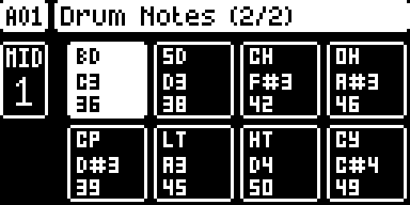
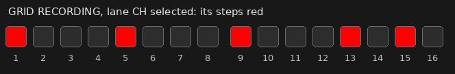
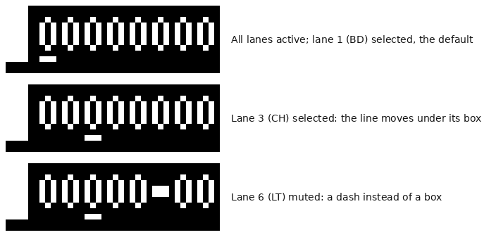
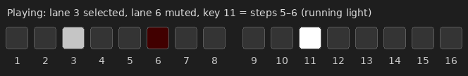

# Drum Mode user manual

**Drum Mode 0.10.4 for the Elektron Digitone mk1 / Digitone Keys, OS 1.44**

Drum Mode turns a Digitone MIDI track into an 8-lane drum sequencer. Trig keys 1–8
become drum pads, each playing its own note on the track's MIDI channel, so you can play,
record and program a whole kit on one MIDI track. The screen and the trig key LEDs show
each drum as it plays.

> **Beta.** 0.10 works on a real Digitone (OS 1.44), with a few known bugs; the fixes in
> 0.10.1 to 0.10.4 are tested in the emulator and wait for the unit. Back up your
> projects before installing. The stock OS can always be reinstalled (see
> [Uninstalling and recovery](#uninstalling-and-recovery)).

## Contents

1. [What you need](#what-you-need)
2. [Installing](#installing)
3. [Uninstalling and recovery](#uninstalling-and-recovery)
4. [Quick start](#quick-start)
5. [Playing the pads](#playing-the-pads)
6. [Setting each drum's note and velocity](#setting-each-drums-note-and-velocity)
7. [Live recording](#live-recording)
8. [Programming steps on the grid](#programming-steps-on-the-grid)
9. [Muting a drum](#muting-a-drum)
10. [What the screen and LEDs show](#what-the-screen-and-leds-show)
11. [Settings per pattern, saving and the stock OS](#settings-per-pattern-saving-and-the-stock-os)
12. [Quick reference](#quick-reference)
13. [Troubleshooting](#troubleshooting)
14. [Limitations](#limitations)

## What you need

- An **Elektron Digitone mk1** or **Digitone Keys** on **OS 1.44**. Drum Mode works with
  that version only.
- A computer with **Elektron Transfer** and a USB cable, to install it.
- A drum machine, sampler or drum plugin that plays drums on one MIDI channel, connected
  to the Digitone's MIDI OUT (or over USB).
- The **stock OS 1.44 file** from Elektron (`Digitone_and_Digitone_Keys_OS1.44.syx`, from
  Elektron's Digitone downloads page). You need it to build the firmware and to go back
  to stock.

## Installing

Drum Mode is installed as a modified OS: your stock OS 1.44 with Drum Mode added. You
send it to the Digitone the same way as an Elektron OS update.

### 1. Get the firmware

There is no download: the firmware contains Elektron's OS, so nobody shares it, not this
project either. You build it from your own copy of the stock OS file.

- **Build it yourself** (Linux, macOS or Windows with WSL). You need git, python3 and an
  m68k cross compiler (on Debian/Ubuntu: `sudo apt install gcc-m68k-linux-gnu`). Then:

  ```
  git clone https://github.com/morriess/Digitone-Drum-Mode.git
  cd Digitone-Drum-Mode
  ./build.sh /path/to/Digitone_and_Digitone_Keys_OS1.44.syx
  ```

  The firmware appears as `out/Digitone_OS1.44_DrumMode.syx` (it shows as OS version
  **D104** for 0.10.4).
- **Later: the elekloader Mod Shop.** Once Drum Mode is listed there, you'll be able to
  tick it in the [Mod Shop](https://elekloader.github.io/shop/) and build the firmware in
  your browser from your own stock OS file.

The file you build is for your own Digitone: don't upload or pass it on, since it contains
Elektron's OS.

### 2. Back up

In Elektron Transfer, back up your projects and sounds. An OS update normally keeps
them, but a backup costs a minute and covers you if anything goes wrong.

### 3. Send it to the Digitone

1. Connect the Digitone to your computer over USB and open **Elektron Transfer**.
2. Select the Digitone and press **Connect**.
3. Drag `Digitone_OS1.44_DrumMode.syx` onto **Drop files here**.
4. Press **YES** on the Digitone when it asks.
5. Wait until the update finishes and the Digitone restarts. **Don't switch it off
   during the update.**

### 4. Check it

The Digitone starts as normal, and the OS version on its boot screen now reads **D1xx**
instead of 1.44 (D104 for 0.10.4).
Hold any track key on its own: a **Mod Menu** opens with a **DRUM MODE** tile. Press
**NO** to close it.

## Uninstalling and recovery

**To go back to stock:** send the stock `Digitone_and_Digitone_Keys_OS1.44.syx` the same
way as above. Your projects stay.

**If the Digitone won't start** after installing (unlikely, but this is beta software):

1. Switch it off.
2. Hold **FUNC** while switching it on. The startup menu appears.
3. Press **TRIG 4** for **OS UPGRADE**.
4. Send the stock OS 1.44 `.syx` with Elektron Transfer (its legacy OS upgrade mode).

The Digitone's startup menu and bootloader are never changed by a mod, so this always
works.

## Quick start

Your first beat in five steps:

1. **Pick a MIDI track:** hold **MIDI** and press **T1**. The track box on the left
   shows `MID 1` (MIDI track A).
2. **Give it a channel:** press **SYN1** (the MIDI Source page). If **CHAN** shows an X,
   hold **FUNC** and push encoder **A** to turn it on, then turn **A** to your drum
   machine's channel (10 for most GM drum kits).
3. **Turn on Drum Mode:** hold **T1** on its own until the Mod Menu opens, then press
   **YES** on **DRUM MODE**. The corner of the screen says `DRUM A ON`.
4. **Play:** trig keys **1–8** are now drum pads. Hit several at once.
5. **Record:** hold **RECORD** and press **PLAY**, play a beat on the pads, and press
   **STOP**. Press **PLAY** to hear it back.

## Playing the pads

With Drum Mode on, trig keys 1–8 are the eight drum lanes:

| Trig key | 1 | 2 | 3 | 4 | 5 | 6 | 7 | 8 |
| --- | --- | --- | --- | --- | --- | --- | --- | --- |
| Drum | Kick (BD) | Snare (SD) | Closed hat (CH) | Open hat (OH) | Clap (CP) | Low tom (LT) | High tom (HT) | Crash (CY) |
| Note | 36 | 38 | 42 | 46 | 39 | 45 | 50 | 49 |

These are the General MIDI drum notes, so most drum machines play the right sounds
straight away. If yours uses other notes, change them (next section). The names are only
labels: any lane can play any note.

- A pad sends a note-on when pressed and a note-off when released, on the MIDI track's
  channel, at that lane's velocity.
- Play as many pads at once as you like.
- Pressing a pad also **selects** that drum for grid editing (not during live recording);
  its key stays lit dim white.
- Trig keys **9–16** don't play anything; while the sequencer runs they show where the
  pattern is (see [the trig key LEDs](#the-trig-key-leds)).
- **Patterns and banks** are picked as usual on a Drum Mode track: PTN then a trig key, PTN
  held + a trig key, BANK + trig 9–16 then a pattern, and chains (hold PTN, press the first
  pattern's trig key, release PTN, and keep that key held while you press the next ones). While
  PTN or BANK is held, and during the stock's pattern/bank select, the trig keys show the stock's
  pattern and bank LEDs (0.10.1). In the SCALE menu (FUNC + PAGE) the trig keys set the
  pattern or track length as usual (0.10.2). The trig keys go to the
  Digitone for those, not to the pads.
- Drum Mode is set per MIDI track, and per pattern: you can have it on for MIDI A and off
  for MIDI B, and on in A01 but off in A02. To turn it off, choose DRUM MODE in the Mod Menu
  again (`DRUM A OFF`).

## Setting each drum's note and velocity

There are two ways: one drum at a time with a held pad, or all eight on the DRUM pages.

### With a held pad

Hold a pad and turn:

- **A** for its **note**. Each new note plays as you turn, so you can find the right
  sound on your drum machine by ear.
- **B** for its **velocity** (1–127).

The corner shows the pad, its note and velocity, e.g. `BD 38 V100`. While you hold the
pad, the knobs only change the pad, not the page underneath.

### On the DRUM pages

Press **LFO**, then press **LFO** again: after the LFO page comes **Drum Notes**, and one
more **LFO** shows **Drum Velocity** (the same page, switched).



The eight knobs match the eight cells:

|  | Knob A | Knob B | Knob C | Knob D |
| --- | --- | --- | --- | --- |
| **Top row** | BD | SD | CH | OH |
|  | **Knob E** | **Knob F** | **Knob G** | **Knob H** |
| **Bottom row** | CP | LT | HT | CY |

- **Drum Notes** shows each lane's note name and number (the Digitone's naming, where 60
  is C5). Turning a knob plays each new note.
- **Drum Velocity** shows each lane's velocity. A muted lane also says `MUTE`.
- The **selected lane** (see [Programming steps on the grid](#programming-steps-on-the-grid))
  has its cell inverted.

On a MIDI track without Drum Mode these pages say `DRUM MODE IS OFF`, and the knobs do
nothing there.

Notes and velocities belong to the track and are saved with the project. Velocity sets
how hard a lane plays, both when you hit its pad and when the sequencer plays it.

## Live recording

1. Hold **RECORD** and press **PLAY**.
2. Play the pads. Each hit is written to the nearest step: a hit in the first half of a
   step lands on that step, a hit in the second half on the next one.
3. Press **STOP** when you're done.

- Several drums on the same step become one trig with several notes (up to 8, so all
  pads fit on one step).
- When a step plays several drums, it plays them at the loudest of their velocities.
- Recording always snaps to the nearest step. The Digitone's own quantize setting for
  live recording doesn't apply to the pads.
- Recorded steps are normal MIDI trigs: they copy, clear and save like any trig.

## Programming steps on the grid

You can also place drums step by step, one drum at a time, like on a Digitakt.

1. **Select a drum:** press its pad (1–8). You hear it, and its key stays lit **dim
   white** (red if the drum is muted), with a small line under its box in the corner
   strip. During live recording a pad doesn't change the selection. To select a drum
   without hearing it, hold the **TRIG** page key and press its pad (the corner says, for
   example, `EDIT CH`).
2. **Enter GRID RECORDING:** press **RECORD** while the sequencer is stopped.
3. **Place steps:** the 16 trig keys are now the selected drum's 16 steps. Press a key to
   put the drum on that step; press it again to take it off. Keys light **red** where the
   selected drum plays.
4. **Switch drums:** leave GRID RECORDING and press another pad, or use TRIG + pad at any
   time. The keys then show the new drum's steps.
5. **Longer patterns:** press **PAGE** to reach steps 17–32, 33–48 and 49–64, as usual.
6. Press **RECORD** again to leave GRID RECORDING.

A step works like a normal trig key too: **hold** it to lock parameters with the knobs,
set micro timing with **LEFT/RIGHT**, copy it with **RECORD** and paste it onto another
held step with **STOP**. A quick tap adds or removes the selected drum; a step held long
or used while held keeps it. Locks apply to the whole step (all drums on it): see
[Limitations](#limitations).



- Other drums on the same steps stay where they are, and don't light up while another
  drum is selected.
- Taking the last drum off a step removes the step's trig.
- Grid editing and live recording write steps the same way, so you can mix them.
- On a Drum Mode track you can't p-lock a step by holding its trig key in GRID
  RECORDING, because the keys belong to the selected drum there.

## Muting a drum

Hold **FUNC** and press a pad to mute that drum; do it again to unmute it. This works when
you're not recording: in GRID, STEP or LIVE RECORDING, FUNC + a trig key does its normal
Digitone job (in GRID RECORDING it places a lock trig).

- The pattern plays on without the muted drum, and its steps stay in the pattern.
- On a step with several drums, only the muted one drops out.
- The corner says `BD MUTE` / `BD ON`. In the corner strip a muted drum shows as a dash,
  its pad lights dim red, and its cell on Drum Velocity says `MUTE`.
- The pad itself still plays (and records) when you hit it.
- Mutes are saved with the project.

## What the screen and LEDs show

### The corner strip

In the top-right corner of the screen, eight tiny boxes show the eight drums, in pad
order:



- **Outline:** the drum is on, not playing right now.
- **Filled:** its pad is held, or the sequencer just played it (a short blink, timed to
  the sound).
- **Dash:** muted.
- **Line under a box:** the selected drum.

Short messages (`DRUM A ON`, `BD MUTE`, `EDIT CH` …) replace the strip for about 2
seconds. While you hold or edit a pad, the corner shows its note and velocity instead.

### The trig key LEDs

Outside GRID RECORDING, pads 1–8 light **white** while held or when their drum plays,
and **dim red** when muted. The selected drum's pad stays **dim white** (**red** if it's
muted).

While the sequencer plays, keys **9–16** are a running light that shows where the
pattern is: each key stands for 2 steps and blinks **white** on each of them, so on a
16-step pattern key 9 blinks for steps 1 and 2, key 10 for steps 3 and 4, and so on up to
key 16. On a longer pattern the keys follow the page that plays: steps 17–32 start again
at key 9. On a shorter or odd length the keys after the last step stay dark, and a key
with only one step blinks once (13 steps: keys 9–14 twice, key 15 once). Dark when
stopped, and in GRID RECORDING keys 9–16 are steps as usual.



In GRID RECORDING the keys show the selected drum's steps in **red** (see above). The
step currently playing shows the Digitone's normal playhead.

More detail, with every screen: [Drum Mode UI additions](ui/README.md).

## Settings per pattern, saving and the stock OS

- **Per pattern and per track** (0.10): each pattern keeps, for each MIDI track, whether
  Drum Mode is on, the mutes, and the notes and velocities. Change the kit on A02 and A01
  keeps its own.
- **A new pattern** (one you haven't used with Drum Mode yet) starts with Drum Mode **off**,
  the default notes and nothing muted (0.10.3). Turn Drum Mode on there to use it. Nothing is
  copied from the pattern you came from; to take a pattern's setup along, copy and paste it
  (below). *This is being tried out.*
- **Copy and paste a pattern** with FUNC + RECORD and FUNC + STOP, and its Drum Mode
  settings come along.
- **Up to 10 different kits per project.** A kit is a set of 8 notes and 8 velocities;
  patterns and tracks with the same notes and velocities share one. With all 10 in use, a
  new note or velocity isn't kept and the corner says `KIT MEM FULL`: set another pattern
  back to an existing kit to free one.
- **Saved in the patterns:** the steps themselves as normal MIDI trigs, and each pattern's
  Drum Mode settings. **Saved with the project:** the kits.
- **A project made without Drum Mode, or with Drum Mode before 0.10,** opens with Drum Mode
  off and the GM notes.
- **Back on the stock OS**, your projects still load, and the patterns play their steps as
  normal MIDI trigs with chords. Mutes and Drum Mode's settings don't apply there. **Don't
  save a project on the stock OS** if you want to keep its Drum Mode settings: the stock OS
  doesn't write them back, so they'd be gone when you reinstall Drum Mode (the steps stay).

### Turning Drum Mode off

Turning Drum Mode off for a track (Mod Menu → DRUM MODE) applies to the pattern you're on
(each pattern has its own on/off). It leaves the pattern's steps untouched, and the Digitone
keeps playing them as ordinary MIDI trigs. Tested in the emulator:

- **The same notes play**, so your drum machine plays the same drums.
- **Mutes stop applying:** a muted drum plays again. The mutes are kept, and work again when
  you turn Drum Mode back on.
- **Velocities change** to the trig's own velocity (VEL on the TRIG page, 100 by default).
  With Drum Mode on, each step plays at the loudest velocity among its drums.
- **The trig keys** are normal trig keys again.
- **From the first step:** a change made while stopped (Drum Mode off or on, a mute, a note
  or a velocity) already applies to step 1 of the next run.

## Quick reference

On a Drum Mode track:

| Action | How |
| --- | --- |
| Turn Drum Mode on/off for this MIDI track | hold a track key → **DRUM MODE** |
| Play a drum | trig keys **1–8** |
| Change a drum's note / velocity | hold its pad + turn **A** / **B** |
| Set all notes / velocities | **LFO**, **LFO** → Drum Notes, **LFO** → Drum Velocity; knobs **A–H** |
| Mute / unmute a drum | **FUNC** + its pad (not while recording) |
| Select a drum for grid editing | its pad (or hold **TRIG** + its pad: silent) |
| Program the selected drum's steps | **RECORD** (stopped), then trig keys **1–16**; **PAGE** for more steps |
| Live record | hold **RECORD** + **PLAY**, play the pads, **STOP** |
| Lock a step, micro timing, copy/paste a step | in GRID RECORDING hold the step + knob / **LEFT**·**RIGHT** / **RECORD**, then another step + **STOP** |
| Pick a pattern or bank, chains | as usual: **PTN** / **BANK** + trig keys (a chain: hold **PTN**, first pattern's key, release **PTN**, keep that key held, next keys) |
| Set the pattern length | as usual: **FUNC** + **PAGE**, then **PAGE** (total) or a trig key (steps) |
| Use Drum Mode on another pattern | go there and turn it on (a new pattern starts with it off) |
| Copy a pattern with its Drum Mode settings | **FUNC** + **RECORD**, go to the other pattern, **FUNC** + **STOP** |

## Troubleshooting

**The pads make no sound on my drum machine.**
- Check **CHAN** on the MIDI track's SYN1 page (MIDI Source). With CHAN off (an X),
  nothing is sent: FUNC + push A turns it on, then set the channel with A.
- Check the Digitone's MIDI output settings: in **SETTINGS > MIDI CONFIG > PORT CONFIG**,
  OUTPUT TO should include the port you use (MIDI, USB, or both).
- Check that your drum machine listens on that channel.

**The wrong drums play.**
Your drum machine uses other notes than General MIDI. Set each pad's note on the Drum
Notes page or with pad + A, by ear.

**`MIDI TRK ONLY` appears when I choose DRUM MODE.**
A synth track is selected. Select a MIDI track first (hold MIDI, press a track key).

**The trig keys do nothing on my track.**
Drum Mode may be on but the track has no channel set: see the first answer. Or you're
in GRID RECORDING (keys edit steps, they don't play): press RECORD to leave it.

**Trig keys 9–16 don't play anything.**
That's right: on a Drum Mode track they only show where the pattern is while it plays
(the running light). In GRID RECORDING they're steps 9–16. FUNC + 9–16 still do their stock
jobs.

**`KIT MEM FULL` appears.**
The project already has 10 different kits (sets of 8 notes and velocities), the most it
can keep. The new note or velocity wasn't kept. Set a pattern you don't need back to the
same notes as another one, or reuse an existing kit, to free one up.

**A pattern has the wrong drum setup.**
Each pattern keeps its own Drum Mode settings, and a pattern you hadn't used before starts
with Drum Mode off and the default notes. Set it up on that pattern, or copy a pattern with
FUNC + RECORD / FUNC + STOP. (Before 0.10.3 a new pattern took a copy of the one you came
from.)

**The Digitone won't start after installing.**
Reinstall the stock OS from the startup menu: see
[Uninstalling and recovery](#uninstalling-and-recovery).

**Something else behaves oddly.**
Please report it, ideally with a photo of the screen, at the repository's
[issues page](https://github.com/morriess/Digitone-Drum-Mode/issues).

## Limitations

- **OS 1.44 only.** Drum Mode uses firmware addresses that only fit OS 1.44. A new
  Elektron OS needs a new Drum Mode build.
- **Beta.** Tested in an emulator and on a unit (0.10 on 2026-11-22; the fixes in 0.10.1 to 0.10.4 not yet); not everything has been tried on hardware yet. The LED colours in
  particular haven't been checked on a real unit.
- **The corner strip covers the tempo** in the top-right corner of the main screen while
  Drum Mode is on.
- **All MIDI tracks** get the DRUM page in their LFO list, including tracks without
  Drum Mode.
- **Locks on drum steps apply to the whole step**, all drums on it. A **NOTE** lock changes the
  step's notes, so it can turn a drum into another one. A **velocity** lock is kept, but on
  playback Drum Mode plays the step at its drums' velocity setting (the loudest one), so the
  lock has no effect.
- **Not yet checked with Drum Mode on:** MUTE mode (FUNC + BANK, then trig keys), STEP
  RECORDING (RECORD + STOP) and pattern copy/paste (PTN + trig key, RECORD / STOP). The trig
  keys may play pads there instead.
- **Combining with DigiArp MIDI** needs DigiArp rebuilt on core 5.3, in the fork
  [morriess/Digitone-MIDI-Arpeggiator, branch core-5.3](https://github.com/morriess/Digitone-MIDI-Arpeggiator/tree/core-5.3): the Mod Shop's version is built on an older
  elekloader core and can't go into one firmware with Drum Mode. Other combinations are
  untested.

---

Drum Mode is free software (GPL-2.0-or-later), made by morriess and built on
[elekloader](https://github.com/irpina/elekloader). It's an unofficial modification, not
made or supported by Elektron. Using it is at your own risk.
