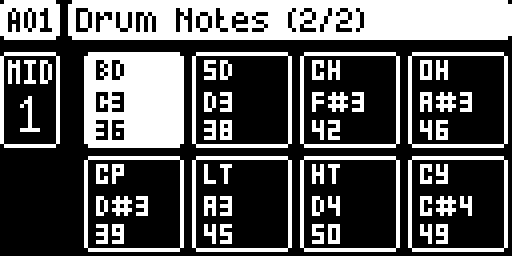

# Drum Mode

A custom-firmware mod for the **Elektron Digitone mk1 (OS 1.44)** that turns one
MIDI track into a drum track with up to **8 lanes**. Each lane sends its own note
on the track's single MIDI channel, so you can play and program several drum
notes at once, and see each lane trigger.

Inspired by the drum sequencers of the Elektron Digitakt and the Arturia
BeatStep Pro. Built on [elekloader](https://github.com/irpina/elekloader)'s
Digitone mk1 core and its sequencer-events mod.

> **Status: 0.8.2, live lanes, live recording, lane mutes, a lane strip that follows
> playback, grid editing per lane, and DRUM pages.** Trig keys 1–8 play 8 drum lanes on a
> MIDI track; live recording writes the pads into the pattern; FUNC + a pad mutes its lane;
> in GRID RECORDING the 16 trig keys edit and show one lane's steps; two DRUM pages set all
> lanes' notes and velocities with the knobs. See [docs/design.md](docs/design.md)
> for the full design and build plan.

> **Beta: working on the unit (0.8.2, 2026-11-18).** Hardware tests on OS 1.44: it boots,
> the pads, their notes and velocities, the DRUM pages and mutes work, and since 0.8.2
> recorded beats play back (0.8 and 0.8.1 wrote them into another pattern; see
> [docs/debugging.md](docs/debugging.md)). A few smaller [known bugs](#known-bugs-possible-fixes)
> remain.

**Docs:** the [user manual](docs/MANUAL.md) (installing, every feature, troubleshooting) and
the [UI additions](docs/ui/README.md) (every screen, key and LED Drum Mode adds).

## Using it (0.8.2)

1. Select a MIDI track (hold MIDI, press a track key) and give it a channel: on its
   SRC page (SYN1), **FUNC + push encoder A** enables CHAN, then turn A to your
   drum machine's channel. With CHAN off (the default) nothing is sent.
2. **Hold a track key** to open the Mod Menu and pick **DRUM MODE** (YES or its
   trig key). The corner shows `DRUM A ON`.
3. Trig keys **1–8** now play the 8 lanes, several at once:

   | Trig | 1 | 2 | 3 | 4 | 5 | 6 | 7 | 8 |
   | --- | --- | --- | --- | --- | --- | --- | --- | --- |
   | Lane | Kick 36 | Snare 38 | Closed hat 42 | Open hat 46 | Clap 39 | Low tom 45 | High tom 50 | Crash 49 |

   The screen's top-right corner shows 8 small boxes: a lane's box lights while its pad
   is held, and blinks each time the sequencer plays it (see [docs/ui](docs/ui/README.md)).
4. **Set a pad's note:** hold the pad and turn **A**. You hear each note as you turn,
   so you can find the right sound on your drum machine by ear. Turn **B** for its
   velocity. The corner shows the pad, its note and velocity, e.g. `BD 38 V100`
   (holding a pad a moment shows it too). While a pad is held the knobs only change
   the pad, not the page underneath.
5. Pick DRUM MODE again to turn it off.

### The DRUM pages

Press **LFO** twice on a Drum Mode track: after the LFO page come **Drum Notes** and
**Drum Velocity** (`LFO (1/3)`, `Drum Notes (2/3)`, `Drum Velocity (3/3)`).



Knobs **A–H** are lanes 1–8, in the same layout as the screen: A–D the top row (BD, SD,
CH, OH), E–H the bottom row (CP, LT, HT, CY).

- **Drum Notes:** each cell shows the lane's note name and number (`D3 38`). Turning a knob
  plays each new note, so you can find the right sound on your drum machine by ear.
- **Drum Velocity:** each cell shows the lane's velocity (1–127); a muted lane says `MUTE`.

The selected lane's cell (TRIG + pad) is inverted. On a MIDI track without Drum Mode the
pages say `DRUM MODE IS OFF`, and the knobs do nothing there.

Holding a pad and turning A/B still works too, from any page.

### Live recording

Start live recording as usual: **hold RECORD and press PLAY**. Play the pads; each hit
is written into the pattern at the nearest step (a hit in the first half of a step lands
on it, in the second half on the next one). Several pads on one step become one trig
with several notes. Stop with STOP.

Recorded hits are normal MIDI trigs: you see them on the grid with Drum Mode off, and
they save, copy and clear like any trig. On playback a step plays at the loudest of its
pads' velocities.

- Recording always snaps to the nearest step; the stock "Live Rec: Quantized/Unquantized"
  setting doesn't apply to the pads.
- A step holds up to 8 notes, so all 8 pads fit on one step.

### Programming a lane on the grid

1. **Select a lane:** hold the **TRIG** page key and press a pad (1–8). No note plays; the
   corner shows `EDIT CH`, and a line under the lane's box in the strip marks the selected
   lane.
2. Press **RECORD** (while stopped) for GRID RECORDING, as you would to place trigs.
3. The 16 trig keys are now the selected lane's steps. Press a key to put the lane on
   that step, press it again to take it off. The keys light **red** where the selected
   lane plays; the rest stay dark, even if other drums play there.
4. Select another lane (TRIG + pad) at any time: the keys switch to that lane's steps.
5. For patterns longer than 16 steps, **PAGE** moves through the pages as usual.

Steps are stored the same way live recording stores them: a normal trig, with several
drums on one step as its chord notes. Taking the last drum off a step removes its trig.
You can mix grid editing and live recording freely.

In GRID RECORDING, a Drum Mode track's trig keys belong to the lane, so holding a trig
key to p-lock it isn't available there.

### The trig key LEDs

Outside GRID RECORDING, pads 1–8 light **white** while held or when the sequencer plays
their lane, and a muted lane's pad is **dim red**. Keys 9–16 stay dark.

### Muting a lane

**FUNC + a pad** mutes that lane: the pattern plays on without it, and its steps stay
in the pattern. FUNC + the pad again unmutes it. The corner shows `BD MUTE` / `BD ON`,
and in the lane strip a muted lane is a dash instead of a box. On a step with several
drums only the muted one drops out. The pad itself still plays (and records) when you
hit it.

The notes, velocities, mutes and which tracks have Drum Mode on are saved with the project.
A project made without Drum Mode starts with the GM notes above and Drum Mode off.

While Drum Mode is on for the selected track, trig keys 9–16 do nothing outside GRID
RECORDING. FUNC + trig keys 9–16 still do what they normally do.

**OS 1.44 only** from 0.4: it uses firmware addresses found in OS 1.44.

## What it will do

- Turn DrumMode on per MIDI track (A–D).
- Nice to have: an 8 × 16 overview of all lanes on the screen.
- All lanes send only on the MIDI track's own channel.

## Milestones

1. Groundwork: build setup on core 5.x, an empty mod that loads and changes nothing
2. Live lanes: trig 1–8 send lane notes in KEYBOARD mode
3. Lane playback through the sequencer hook
4. Lane storage in the pattern, drum map in the project
5. Grid editing, lane select and per-lane trig LEDs *(0.7)*
6. *Nice to have:* screen grid of all lanes. Lightest form: an 8 × 16 overview shown only while
   TRIG is held (as when selecting a lane), the selected lane highlighted. Waiting on hardware testing.
7. Polish: lane mute, DRUM page, LIVE REC *(lane mute 0.5, live rec 0.4, DRUM pages 0.8)*

**Nice to have, after hardware testing:** a revised DRUM settings page (its place behind LFO,
its layout, what it shows) once it has been used on a unit.

**Nice to have:** drum kit presets: save a Drum Mode track's setup (8 notes, velocities, mutes)
as a kit and load it onto any MIDI track. Kits saved in the project are possible now; kits
shared across projects need storage outside the project, which the Digitone mk1's core doesn't
offer yet (a SysEx dump to the computer and back would be the workaround).

**Nice to have:** synth tracks as extra drum tracks. More than 8 tracks isn't realistic (the
pattern and project format has exactly 4 synth + 4 MIDI tracks), but a synth track you don't
need could send its steps as MIDI through Drum Mode, its own voice kept silent: up to 8 drum
tracks. The same could make a synth track a **normal MIDI track** (its steps sent as plain
MIDI notes, without Drum Mode's lanes), for up to 8 MIDI tracks of any kind. The hard part is
timing (sending each note at the moment it plays, plus its note-off), so this waits until the
current version has run on a unit.

**Improvement (asked 2026-11-18, after the first working hardware test):** pick a lane with
its pad alone. Pressing trig key 1-8 selects that lane (voice), and its key stays lit as the
selected one. When you then press RECORD (GRID RECORDING), the trig keys place and show trigs
for that lane only, never the other lanes' steps. Today a lane is selected with TRIG held + pad
(a pad on its own plays the drum), and GRID RECORDING already shows only the selected lane, so
the change is mainly selecting by the pad itself and the lit key. Decided: a pad still plays
its drum when pressed to select it. Still to decide: how that fits with live recording, where
the pads play and record.

## Known bugs (possible fixes)

- **Recorded beats don't play back on the unit (fixed in 0.8.2, confirmed on the unit 2026-11-18).** Found on
  hardware with 0.8 (2026-11-17). Live recording with Drum Mode on writes trigs at the
  right moments, but pressing PLAY afterwards sends nothing at all (the drum machine's MIDI
  light stays dark), with Drum Mode still on. Pads play fine, nothing is muted, velocities
  are normal. A normal trig placed with Drum Mode off plays on the same track; setting
  ROOT to the drum's note on a recorded step doesn't help. In the emulator the same steps
  (lanes' notes changed, velocities changed, mute/unmute, then live recording) record the
  right note (67) and play it back. Holding a recorded step shows ROOT C5 (60) in both
  places: Drum Mode stores the drum as the step's note, which ROOT doesn't show (a display
  issue to fix too). Debug build 1 (DRMD) on the unit: recorded steps never
  reach Drum Mode's playback with a note, while normal trigs do and come out as 67, so the
  fault is in what recording stores. Debug build 2 (DRD2): the step is stored right (trig
  on, note 67) but the sequencer never sees it. *Cause:* the project keeps a set of track
  edit objects per pattern (128); 0.8 always used A01's, so on any other pattern the beats
  went into A01. 0.8.1 also tried A02's (enough for the emulator test on A02, not for the
  unit on H02; debug build 3 showed it). *Fix (0.8.2):* use the active pattern's own set.
  Reproduced and fixed in the emulator on H02 (`tests/test_other_pattern.py`). The process and
  results: [docs/debugging.md](docs/debugging.md).

- **PATTERN or BANK + a trig key plays a pad instead of choosing the pattern** (found in
  the emulator, 0.8.1). On a Drum Mode track, Drum Mode takes every trig key press, also
  right after [PTN] or [BANK], so pattern and bank select (and chains) don't work there.
  *Possible fix:* after [PTN] or [BANK], leave the trig keys to the stock until the
  selection ends (a pick, [NO], or its four seconds). Until then: pick the pattern on
  another track, or with Drum Mode off.

- **Step 1 after PLAY follows the old setting.** The Digitone prepares each step one step
  ahead, and step 1 of a new run is prepared when the previous run stops. So right after you
  turn Drum Mode off or on, or change a mute or velocity while stopped, step 1 of the next run
  still plays the old way; from step 2, and from the next run on, everything follows the new
  setting. *Possible fix:* when such a setting changes while stopped, have the sequencer
  prepare step 1 again. First step: find where the firmware prepares that step (OS 1.44).
  Found in the emulator with `tests/test_drum_off.py`; details in
  [docs/design.md](docs/design.md) ("Drum Mode off").
- **The UI froze with the Mod Menu open (emulator only, cause unknown).** In one exact
  sequence of `tests/test_drum_off.py` (Drum Mode turned off, two bars played, trig key 1
  pressed, then the Mod Menu opened with YES straight after letting go of the track key), the
  screen and keys stopped responding while the sequencer and audio kept running. It happened
  every time in that sequence, but not with a short pause before YES, not without the trig
  key press, and not in shorter scripts with the same steps, so it may be the emulator, the
  core's Mod Menu, the stock OS or Drum Mode. *Next:* watch for it on the unit (the Mod Menu
  stops responding to YES, NO and the page keys). Details in
  [docs/design.md](docs/design.md) ("Open: a UI hang in the emulator").
- **The lane strip sometimes disappears when switching pages (on the unit).** Reported on
  hardware (0.8, 2026-11-17) while browsing between pages, e.g. LFO and then SYN1; not seen in
  the emulator, where the strip was there after every page switch. To check: whether it
  happened on Drum Notes / Drum Velocity (the strip is left out there on purpose, so the title
  stays readable), and whether it comes back by itself or only on a pad hit. *Possible fix:*
  Drum Mode redraws the corner only when something in it changes; if the Digitone sometimes
  repaints the whole page after Drum Mode has drawn, the strip stays wiped until the next
  change. Also asking for a redraw whenever the shown page changes would cover that.
- **The DRUM pages clash with DigiTables.** Drum Mode's two pages use mod page slots 27 and
  28; DigiTables (irpina) also claims 27, so the two can't be built into one firmware.
  DigiTables only exists for OS 1.43 so far, so this doesn't matter on 1.44 yet. *Possible
  fix:* move the pages to 28 and 29 (29 clashes with CTRL-PLUS instead, which needs an older
  core anyway). Slot 30 is out: core claims it for the second TRIG page as soon as a mod puts
  knobs there (DigiChoke, DigiLoop, DigiPCSound).

## Building

You need your own copy of the stock Digitone OS 1.44 `.syx` from Elektron, plus
git, python3 and an m68k cross toolchain (`m68k-elf-gcc` or `m68k-linux-gnu-gcc`;
on Debian/Ubuntu: `apt install gcc-m68k-linux-gnu`).

```
./build.sh /path/to/Digitone_and_Digitone_Keys_OS1.44.syx
```

This fetches [elekloader](https://github.com/irpina/elekloader) at a fixed commit
(core-dn1 5.3, seq-events-dn1 0.1), builds them and the mod in `src/`, checks they
combine, and writes `out/Digitone_OS1.44_DrumMode.syx`, shown as OS version
**DR82** on the unit.

**Never commit Elektron's OS files or built firmware to this repo**: `.gitignore`
blocks `*.syx`, `*.bin` and `*.elemod`.

## Testing in the emulator

The tests run the real firmware in [digiemu](https://github.com/irpina/digiemu),
press keys and check the MIDI the Digitone sends:

```
git clone https://github.com/irpina/digiemu ~/digiemu
cd ~/digiemu && uv sync && tools/install-patched-unicorn.sh
DIGIEMU=~/digiemu uv run --project ~/digiemu python tests/test_live_lanes.py out/Digitone_OS1.44_DrumMode.syx
DIGIEMU=~/digiemu uv run --project ~/digiemu python tests/test_assign_notes.py out/Digitone_OS1.44_DrumMode.syx
DIGIEMU=~/digiemu uv run --project ~/digiemu python tests/test_live_record.py out/Digitone_OS1.44_DrumMode.syx
DIGIEMU=~/digiemu uv run --project ~/digiemu python tests/test_lane_mute.py out/Digitone_OS1.44_DrumMode.syx
DIGIEMU=~/digiemu uv run --project ~/digiemu python tests/test_strip_playback.py out/Digitone_OS1.44_DrumMode.syx
DIGIEMU=~/digiemu uv run --project ~/digiemu python tests/test_grid_edit.py out/Digitone_OS1.44_DrumMode.syx
DIGIEMU=~/digiemu uv run --project ~/digiemu python tests/test_drum_page.py out/Digitone_OS1.44_DrumMode.syx
DIGIEMU=~/digiemu uv run --project ~/digiemu python tests/test_drum_off.py out/Digitone_OS1.44_DrumMode.syx
```

The first run sets up the firmware (a few minutes); screenshots land in the work folder.

## Layout

| Path | What |
| --- | --- |
| `src/mod.json` | Mod manifest: events it subscribes to, what it needs |
| `src/drummode.c` | The mod |
| `build.sh` | Builds the firmware from your stock OS file |
| `tests/emu_session.py` | Drives the firmware in digiemu: keys, MIDI out, screen |
| `tests/test_live_lanes.py` | The pads: notes, chords, note-offs, FUNC + pad, the corner (21 checks) |
| `tests/test_assign_notes.py` | Setting notes and velocities, saving with the project (21 checks) |
| `tests/test_live_record.py` | Live recording: step timing, chords, playback, no stray stock trigs (15 checks) |
| `tests/test_lane_mute.py` | Lane mutes: playback without muted lanes, chords, the strip (10 checks) |
| `tests/test_strip_playback.py` | The strip blinking on playback, on time; not over menus (11 checks) |
| `tests/test_grid_edit.py` | Lane select, grid editing with pages, the trig key LEDs (26 checks) |
| `tests/test_drum_page.py` | The DRUM pages: knobs set notes and velocities, the pages underneath untouched (15 checks) |
| `tests/test_drum_off.py` | A beat with Drum Mode on, off and on again: what plays, what's kept (17 checks) |
| `docs/design.md` | Design and build plan |
| `docs/ui/` | The screen UI explained, with screenshots |

## Disclaimer

Unofficial, experimental firmware. Not affiliated with or supported by Elektron.
Back up your projects before flashing, and keep the stock OS file to restore.
