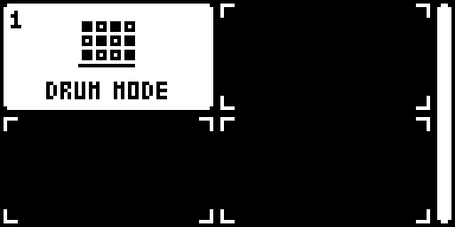
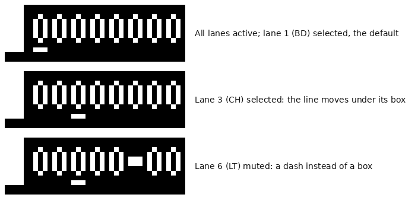
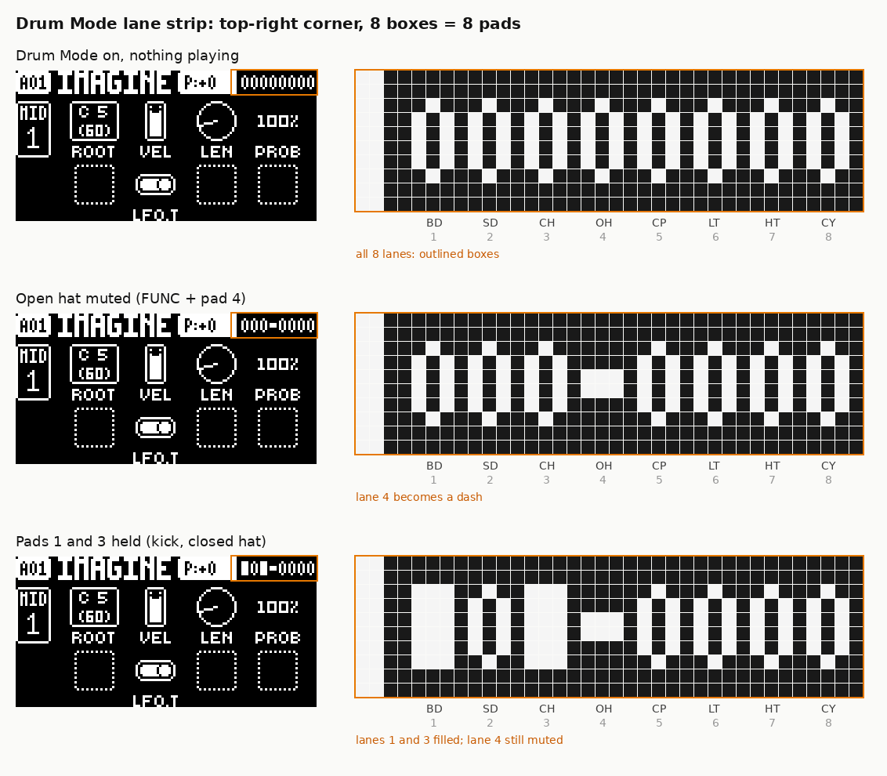
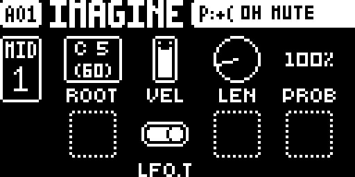
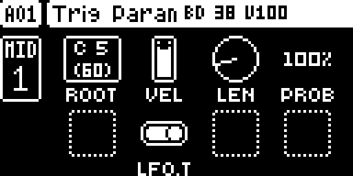
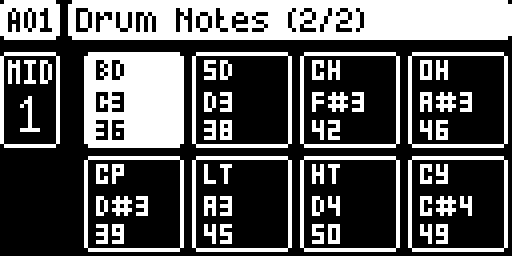
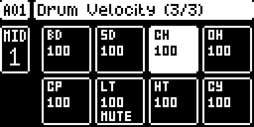
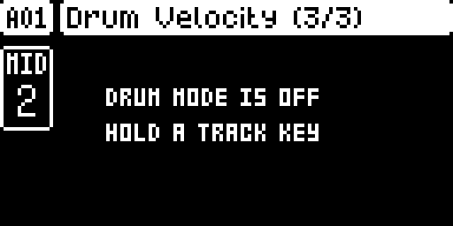
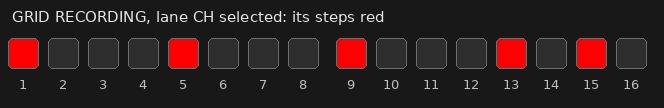
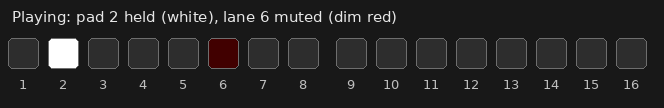

# Drum Mode UI additions

Everything Drum Mode adds to the Digitone mk1's screen, keys and LEDs, as of **0.8**.
For how to install and use it step by step, see the [user manual](../MANUAL.md).

The screenshots are of the real firmware running in
[digiemu](https://github.com/irpina/digiemu). The LED pictures are drawn from the LED
colours the emulated panel received. Nothing here has been checked on a real unit yet.

## Contents

1. [Overview](#overview)
2. [The Mod Menu entry](#the-mod-menu-entry)
3. [The corner of the screen](#the-corner-of-the-screen)
   - [The lane strip](#the-lane-strip)
   - [Messages](#messages)
   - [Pad info](#pad-info)
4. [The DRUM pages](#the-drum-pages)
5. [The trig keys](#the-trig-keys)
6. [The trig key LEDs](#the-trig-key-leds)
7. [What stays stock](#what-stays-stock)
8. [Design rules](#design-rules)
9. [Known limitations](#known-limitations)
10. [Where it is in the code](#where-it-is-in-the-code)

## Overview

Drum Mode adds UI in five places. Most of it appears only while the selected track is a
MIDI track with Drum Mode on (a "Drum Mode track"):

| Where | What | Since |
| --- | --- | --- |
| Mod Menu | a **DRUM MODE** tile that turns Drum Mode on or off for the selected MIDI track | 0.1 |
| Screen, top-right corner | the **lane strip**: 8 boxes that light when a lane plays; short **messages**; the held pad's **info** | 0.2–0.7 |
| Screen, two new pages | **Drum Notes** and **Drum Velocity**, behind the MIDI track's LFO page | 0.8 |
| Trig keys | pads 1–8 play the lanes and select them (0.9; not while live recording); TRIG + pad selects silently; FUNC + pad mutes; in GRID RECORDING the keys edit the selected lane | 0.1–0.7 |
| Trig key LEDs | the pads' state, or in GRID RECORDING the selected lane's steps | 0.7 |

Drum Mode works on the 8 lanes of one MIDI track at a time:

| Pad | 1 | 2 | 3 | 4 | 5 | 6 | 7 | 8 |
| --- | --- | --- | --- | --- | --- | --- | --- | --- |
| Short name | BD | SD | CH | OH | CP | LT | HT | CY |
| Lane | Kick | Snare | Closed hat | Open hat | Clap | Low tom | High tom | Crash |
| Default note (GM) | 36 | 38 | 42 | 46 | 39 | 45 | 50 | 49 |

The short names are labels only. Each lane plays whatever note you give it.

## The Mod Menu entry

Hold a track key on its own to open elekloader's Mod Menu. Drum Mode's tile is
**DRUM MODE**, with a pad-grid icon. Choosing it (YES, or the tile's trig
key) turns Drum Mode on or off for the selected MIDI track, A–D. Each track remembers its
own setting, and the setting is saved with the project.

The corner confirms with `DRUM A ON` or `DRUM A OFF` (the letter is the MIDI track). On
a synth track the tile shows `MIDI TRK ONLY` and changes nothing.

## The corner of the screen

On a Drum Mode track, Drum Mode draws in the **top-right corner** of the screen, over
the right end of the title bar. It only draws there on the parameter pages and the main
screen, never over the settings menus, the project list, TEMPO or other full screens. On
the DRUM pages the corner stays empty, except for messages.

The corner shows one thing at a time, in this order of priority:

1. a **message**, for about 2 seconds;
2. the held pad's **info**, while you hold or edit a pad;
3. otherwise, the **lane strip**.

### The lane strip

Eight tiny boxes, one per lane, in pad order (BD on the left, CY on the right).

| Look | Meaning |
| --- | --- |
| Outline (looks like a small "0") | Lane active, not playing right now |
| Filled | The pad is held or was just hit, or the sequencer just played the lane (a short blink) |
| Dash | Lane muted (FUNC + pad) |
| Line under a box | The selected lane, the one GRID RECORDING edits (its pad, or TRIG + pad) |

- **Following playback.** The Digitone's sequencer prepares each step one step before it
  plays it, and that's when Drum Mode sees the step's lanes. Drum Mode holds them back a
  step, so a box blinks exactly when its lane sounds. A playback blink (about 0.1 s) is
  shorter than a pad hit's, so lanes on back-to-back 16ths still blink separately.
- **Mutes.** A muted lane doesn't blink on playback, because the sequencer leaves it out.
  Its pad still lights the box when you hit it, since the pad still plays.
- **Size and place.** Each box is 3 × 6 pixels with 1 pixel between boxes, 31 pixels
  wide in all, at x 96–126 and rows 2–7 of the 128 × 64 screen (row 0 at the top). The
  selection line is row 9. Drum Mode clears x 94–127, rows 0–9, before drawing.
- **Drawing.** The corner is cleared to black and the boxes are drawn by inverting
  pixels, so they look the same on every page whatever the page drew underneath.
- **Updates.** The corner is only redrawn when something in it changes: a hit, a
  release, a mute, a selection, a blink running out.

### Messages

Short confirmations replace the strip for about 2 seconds: black text in a white box
(x 84–127, rows 0–9).

| Message | When |
| --- | --- |
| `DRUM A ON` / `DRUM A OFF` | DRUM MODE chosen in the Mod Menu (A–D: the MIDI track) |
| `MIDI TRK ONLY` | DRUM MODE chosen while a synth track is selected |
| `BD MUTE` / `BD ON` | FUNC + a pad mutes or unmutes its lane |
| `EDIT BD` | TRIG + a pad selects its lane for GRID RECORDING |

### Pad info

While you hold a pad and turn **A** (note) or **B** (velocity), or hold a pad for a
moment, the corner shows the lane, its note number and velocity, e.g. `BD 38 V100`. It's
wider than the strip (x 64–127), stays while the pad is held, and disappears about 3
seconds after you let go.

## The DRUM pages

Two pages for setting all 8 lanes at once. On a Drum Mode track, press **LFO**: the LFO
page shows `LFO (1/3)`, and pressing LFO again steps to **Drum Notes (2/3)** and then
**Drum Velocity (3/3)**.

| Drum Notes | Drum Velocity |
| --- | --- |
|  |  |

**Layout.** Eight cells in the knobs' layout: knobs **A–D** are the top row (BD, SD, CH,
OH), knobs **E–H** the bottom row (CP, LT, HT, CY). Each cell is 25 × 24 pixels, in the
area x 20–127, rows 12–63, where the stock pages draw their knobs. The MIDI track box
on the left and the title bar stay stock.

**Drum Notes.** Each cell shows the lane's name, its note name and its note number,
e.g. `D3` and `38`. Note names follow the Digitone's own convention: 60 is C5, so 36 is
C3. Turning a knob changes the note one semitone per click and plays each new note, so
you can find the right drum on your drum machine by ear.

**Drum Velocity.** Each cell shows the lane's name and velocity (1–127). A muted lane's
cell also says `MUTE`. Turning a knob changes the velocity and plays nothing.

**The selected lane** (its pad, or TRIG + pad) is shown with its cell inverted, white with black
text, on both pages.

**On a MIDI track without Drum Mode** the two pages still appear in the LFO list (they
belong to all MIDI tracks), but show a hint and ignore the knobs:

**Why behind LFO.** Behind SYN1, after MIDI Source, the pages broke the stock FUNC +
push A that turns CHAN on. Behind TRIG, every lane select (TRIG + pad) would also flip
the page. LFO was the cleanest place. (Details in [the design notes](../design.md).)

**How they're made.** The pages are two extra pages with empty knob boxes. Drum Mode
clears the boxes and draws the cells itself, and handles the knobs while a DRUM page is
shown. So Drum Mode doesn't use any of elekloader's 10 shared parameter slots, which
other mods may need.

## The trig keys

On a Drum Mode track the 16 trig keys work like this:

| Keys | Outside GRID RECORDING | In GRID RECORDING |
| --- | --- | --- |
| Trig 1–8 | play lanes 1–8 (several at once); recorded while live recording | the selected lane on/off on that step |
| Trig 9–16 | nothing | the selected lane on/off on that step |
| Hold a pad + turn A / B | the pad's note / velocity | (pads are steps here) |
| TRIG (page key) held + trig 1–8 | select that lane, no sound | same |
| FUNC + trig 1–8 | mute / unmute that lane | same |
| FUNC + trig 9–16 | the stock function | the stock function |

**GRID RECORDING** is the stock step-programming mode: press RECORD while stopped. In
it, trig key *n* means step *n* of the page shown, so with **PAGE** you reach steps
17–64 of longer patterns. Adding a lane to a step that already has drums adds its note
to that step's chord. Removing the last drum from a step removes the step's trig.

**Live recording** (hold RECORD, press PLAY) records pad hits onto the nearest step.

**Lane select** works in any mode and on any page. Drum Mode only watches the TRIG key,
so it keeps its normal job of opening the TRIG page.

## The trig key LEDs

On a Drum Mode track Drum Mode sets all 16 trig key LEDs. What they show depends on the
mode.

**In GRID RECORDING:** the selected lane's steps.

| Key | LED |
| --- | --- |
| A step where the selected lane plays | red |
| Any other step, even if other lanes play there | dark |
| The step playing right now (while the sequencer runs) | the stock's playhead |
| A step past the track's length | the stock's |

**Otherwise:** the pads.

| Key | LED |
| --- | --- |
| Pad 1–8 held, or its lane just played | white |
| Pad 1–8 of a muted lane | dim red |
| Pad of the selected lane (0.9) | dim white; red if muted |
| Any other key | dark |

Drum Mode sets its LEDs first in each LED update, so they take priority over the stock
LEDs on the same keys. Synth tracks and MIDI tracks without Drum Mode keep the stock
LEDs.

## What stays stock

- Synth tracks and MIDI tracks without Drum Mode work exactly as before (apart from the
  two extra pages in a MIDI track's LFO list).
- All other keys, pages and menus are stock, and so are FUNC + trig 9–16.
- Recorded and grid-programmed steps are normal MIDI trigs. With Drum Mode off you see
  and edit them like any trig, and they copy, clear and save like any trig.

## Design rules

The rules the UI follows, which any future change should keep:

1. **Only where it's needed.** Nothing changes on synth tracks or on MIDI tracks without
   Drum Mode.
2. **Never cover the stock UI's important parts.** The corner is drawn only on the
   parameter pages and the main screen, never over menus or full screens.
3. **Look the same on every page.** The strip inverts pixels instead of assuming a
   background.
4. **Feedback first.** Every action gets a visible answer: a message, a lit box, an LED,
   or a sound (a note played as you set it).
5. **Stay out of the way.** Messages go away by themselves; the corner redraws only on
   changes.
6. **Store steps the stock way.** Steps are ordinary trigs and chord notes, so a pattern
   still makes sense with Drum Mode off, or on the stock OS.

## Known limitations

- **The strip covers the tempo display** in the top-right corner of the main screen
  while Drum Mode is on.
- **The strip is small:** a glance indicator, not a replacement for real feedback.
- **No p-locks by holding a trig key** in GRID RECORDING on a Drum Mode track, because the
  keys belong to the selected lane there.
- **All MIDI tracks get the two DRUM pages** in their LFO list, including tracks without
  Drum Mode.
- **The LED colours are from the emulator's copy of the panel's colour table** (dark,
  red, dim red, white). They should match the unit, but that hasn't been checked on
  hardware yet.

Nice to have, after hardware testing (see the [README](../../README.md#milestones)):

- an overview of all 8 lanes × 16 steps on the screen, for example only while TRIG is
  held;
- a revised DRUM settings page, once the current one has been used on a unit.

## Where it is in the code

All in [../../src/drummode.c](../../src/drummode.c):

| Function | What it does |
| --- | --- |
| `dm_draw` | draws the corner and the DRUM pages' cells (only when `on_page()`: the view on top is a parameter page) |
| `draw_drum_page` | the 8 cells of Drum Notes or Drum Velocity, or the hint on a track without Drum Mode |
| `dm_tick` | the UI tick: turns played lanes into blinks, counts down blinks and messages, asks for a redraw and an LED update |
| `dm_leds` | the trig key LEDs, in each LED update before the stock ones |
| `dm_key` | the trig keys: pads, lane select, mutes, GRID RECORDING |
| `dm_enc` | the knobs: a held pad's note and velocity, and the DRUM pages |
| `drum_page` | which DRUM page is shown, if any |
| `dm_fire_notes`, `dm_gen_trig` | at the sequencer's level: which lanes a step plays, mutes dropped |
